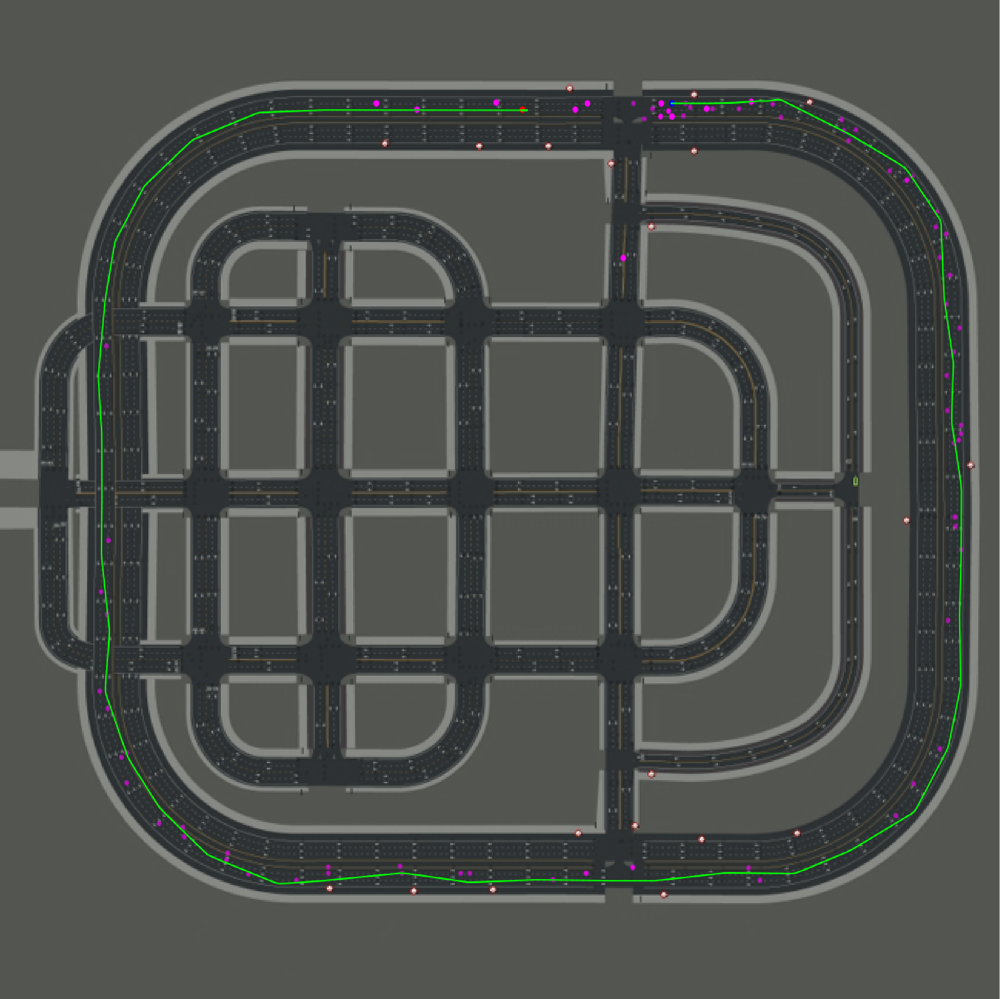
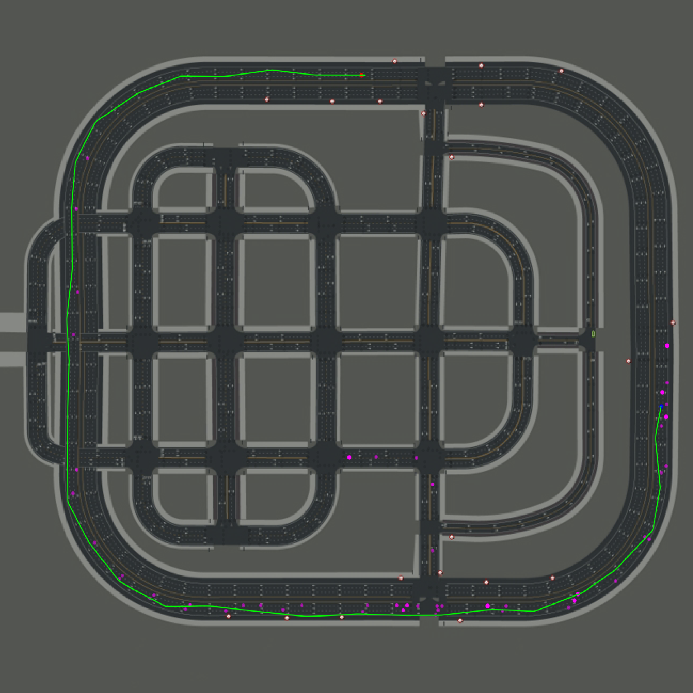

# Lane-change RL: DQN vs Double DQN vs Dueling Double DQN in CARLA

**Should the car stay in its lane, move left or move right?** This project trains deep Q-learning agents to make that decision on a three-lane road in the CARLA driving simulator. It compares three architectures: DQN, Double DQN (D2QN) and Dueling Double DQN (D3QN).

> Summer Internship 2023, National Institute of Technology Tiruchirappalli, under the guidance of Dr S. Usha Kiruthika. Full write-up: [Report.pdf](Report.pdf).



*Top-down view of CARLA Town05 from a D3QN test run, the same figure as the D3QN result in the report. The green line is the ego car's path from its start (red) to its end (blue). Purple dots are the other vehicles.*

## The problem

A lane change needs a quick judgement about the gaps, distances and speeds of the cars around you.

- **Rules don't adapt well.** Rule-based lane changing relies on fixed heuristics and struggles in dynamic, unpredictable traffic.
- **Reinforcement learning (RL) learns from outcomes.** An RL agent learns which action pays off in each traffic situation. It is penalised for collisions and rewarded for keeping up speed.
- **Which RL model works best?** DQN, Double DQN and Dueling Double DQN handle value estimation differently. This project compares them in the same simulated scenario.

## What it does

| | |
|---|---|
| **Simulated highway** | CARLA `Town05`, synchronous mode at 20 Hz. A Tesla Model 3 ego car starts in the centre of three lanes. |
| **Live traffic** | A new autopilot vehicle spawns 70 m ahead, in a random lane, every 4 steps. CARLA's Traffic Manager drives it. |
| **Grid state** | A 45 × 3 grid (2 m cells × 3 lanes, up to 60 m away) holds the speed of each nearby car. The D3QN also gets a 3-value vector of ego speed and lane. |
| **Three actions** | 0 = follow the lane, 1 = change left, 2 = change right. A PID controller drives the car to waypoints 45 m ahead in the target lane. |
| **Reward** | −10 and episode end on collision. +3 per step at or above 45 km/h, −1 below. −3 for trying to leave the road (left from the left lane, right from the right lane). |
| **Three agents** | `DQNAgent`, `DoubleDQNAgent` and `DuelingDoubleDQN` in [DQN.py](DQN.py). All share the same convolutional trunk. |
| **Trajectory plots** | After each episode, the ego path and other vehicles are drawn over the Town05 waypoint map. |

## How it works

```
CARLA server (Town05, sync 20 Hz)
   │  carla.Client("localhost", 2000) · Traffic Manager on port 9500+
   ▼
Player (train.py / test.py)
   ├─ reset()        load Town05 · spawn ego Model 3 · collision sensor
   ├─ spawn_vehicle  every 4 steps: autopilot car 70 m ahead in a random lane
   ├─ get_state_representation()
   │       45×3 grid: other cars' speed/100 per 2 m cell per lane, ego speed in its own cell
   └─ step(action)   0 follow · 1 left · 2 right
           └─ VehiclePIDController (controller.py) → waypoints 45 m ahead → world.tick()
   │  state, pos, reward, done
   ▼
Agent (DQN.py)
   ├─ Conv2D(64,4×2) → Conv2D(64,4×2) → Conv2D(3,1×1) → Dense 256 → Dense 64
   ├─ DQN / Double DQN head: Q(s, a) for 3 actions
   ├─ Dueling head: V(s) + (A(s,a) − mean A), with the ego speed/lane vector concatenated
   ├─ two replay buffers: lane-change moves vs follow-lane moves, sampled 50/50
   └─ target network copied every 10 steps · γ = 0.9
```

**Notable design decisions:**
- **Separate replay buffers for lane changes.** Following the lane is far more common than changing lanes. Sampling half of each minibatch from each buffer keeps the rare lane-change experiences in training.
- **A speed grid instead of camera images.** The state is a compact 45 × 3 grid of nearby vehicles' speeds, not raw pixels. This keeps the networks small.
- **Planned epsilon schedule.** Training starts with pure exploration (ε = 1). The code sets ε-decay to 0.99985 from episode 6, with a floor of 0.10 from episode 41 and 0.03 from episode 71. See [Limitations](#limitations).

## Results

The report compares the three models qualitatively, by the trajectories they drive in the final test. **The repository contains no quantitative metrics**, such as success rate, collision rate or reward curves.

From [Report.pdf](Report.pdf), section 3.4:

| Model | Report's finding |
|---|---|
| DQN | Erratic at first, then smoother lane changes over later iterations. It still struggles in complex traffic. |
| Double DQN (D2QN) | Consistent, smooth lane changes in response to surrounding traffic in the final test. |
| Dueling Double DQN (D3QN) | Best of the three in the final test, with precise lane changes in challenging traffic. |

Trajectory plots in this repository (each one matches a figure in the report):

| D2QN test run | D3QN test run |
|---|---|
|  |  |

The DQN trajectories for the initial, middle and final iterations appear only in the report.

## Repository layout

```
├── train.py            CARLA environment (Player class) + D3QN training loop (1,000 episodes, 6 min each)
├── test.py             Same environment; loads a saved .h5 checkpoint and runs 20 greedy (ε = 0) episodes
├── DQN.py              DQNAgent, DoubleDQNAgent and DuelingDoubleDQN (Keras / TensorFlow 1 compat)
├── controller.py       Vehicle PID controller (lateral + longitudinal), from CARLA's agents package
├── misc.py             CARLA helper functions (speed, distances, waypoint drawing), from CARLA's agents package
├── start-server.sh     Starts CARLA 0.9.10.1 headless with Singularity on a GPU cluster
├── models/
│   ├── train_c.txt     Training log: episode number and epsilon
│   ├── trainexp1_c.pkl Pickled replay buffer of lane-change experiences
│   └── exp2_c.pkl      Pickled replay buffer of follow-lane experiences
├── plots/
│   ├── test.png        D3QN trajectory on Town05
│   └── town_5.png      D2QN trajectory on Town05
└── Report.pdf          Internship report (methodology, implementation, results)
```

Trained `.h5` weights are not included.

## Quick start

There is no requirements file. The code expects the CARLA Python API, TensorFlow and Keras (TF1-compatibility mode), NumPy, OpenCV, Matplotlib and tqdm. The committed `__pycache__` shows it was run on Python 3.7 to 3.10.

1. **Start a CARLA server** with `Town05` available. Locally, run `CarlaUE4` (port 2000 by default). On a Singularity cluster, use [start-server.sh](start-server.sh), but change `-carla-port=1555` to `2000` or edit the port in `train.py`.
2. **Make the `carla` module importable.** The scripts look for `../../carla/dist/carla-*.egg`, so clone this repo two levels below CARLA's `PythonAPI/` folder. Alternatively, `pip install carla` with the matching version.
3. **Fix the output paths.** `train.py` and `test.py` save trajectory plots to a hard-coded `C:\Users\Lohesh\...\eval_visualizations\` folder. Point it at a folder that exists.
4. **Train:**
   ```bash
   python train.py      # saves models/<episode>.h5, appends to models/train_c.txt
   ```
5. **Test:** set the checkpoint path in `agent.load(...)` near the bottom of `test.py`, then:
   ```bash
   python test.py       # 20 episodes with epsilon = 0; prints scores, writes scores.txt / avg_scores.txt
   ```

`train.py` trains `DuelingDoubleDQN`. To train the other agents, change the `agent = ...` line. Note that `DQNAgent.act` and `DoubleDQNAgent.act` take only the grid, not the `[grid, pos]` pair the loop passes.

| Setting (in code) | `train.py` | `test.py` |
|---|---|---|
| Target speed `VEHICLE_VEL` | 45 km/h | 30 km/h |
| Episodes | 1,000 | 20 |
| Batch size | 16 | 32 |
| Episode length | 6 min | 6 min |

## Limitations

- **No quantitative evaluation.** The model comparison is qualitative. Success and collision rates are described in the report but never computed in the code.
- **Epsilon never decays in the code.** `epsilon_decay` and `epsilon_min` are set, but nothing multiplies `epsilon` by the decay. Every logged episode in `models/train_c.txt` (up to episode 17) shows ε = 1.0, so those runs took random actions.
- **"Double DQN" is the same code as DQN.** `DoubleDQNAgent` is identical to `DQNAgent`. Both use the target network's max Q-value and don't select actions with the online network. Only the dueling agent uses the Double-DQN target.
- **Input shapes may not match.** The loop reshapes states to `[-1, 1, 45, 3]`, while the dueling network declares an input of `(45, 3, 1)`. The training loop catches exceptions and ends the episode, so errors can pass silently.
- **Hard-coded paths and ports.** The output plot folder and test checkpoint are Windows paths. `start-server.sh` uses port 1555, but the client connects to 2000.
- **Old APIs.** The code uses `tensorflow.compat.v1` with `disable_v2_behavior()` and Keras `Adam(lr=...)`. It targets CARLA 0.9.x.
- **No trained weights.** Only the replay buffers and the log are committed.

## Credits

- **Author:** Lohesh M (Shiv Nadar University Chennai).
- **Guide:** Dr S. Usha Kiruthika, Assistant Professor, Department of Computer Science and Engineering (internship at NIT Tiruchirappalli).
- **CARLA code.** `controller.py` and `misc.py` are adapted from the CARLA simulator's Python API `agents` package.

## Licence

MIT. See [LICENSE](LICENSE). `controller.py` and `misc.py` come from CARLA's Python API, which is MIT-licensed by its authors. CARLA itself and its maps are subject to the CARLA licence.
